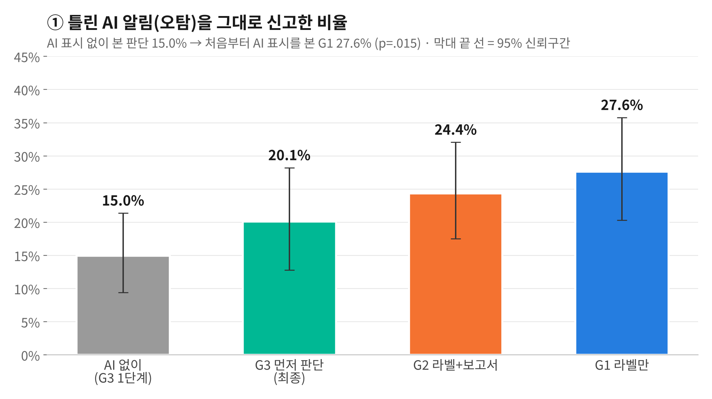
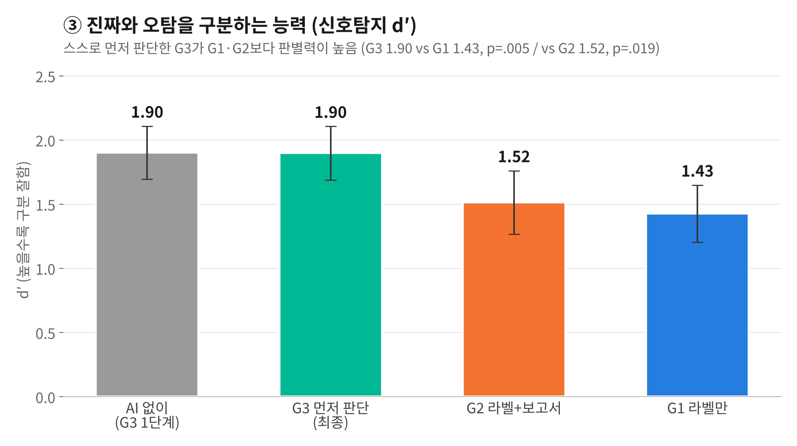
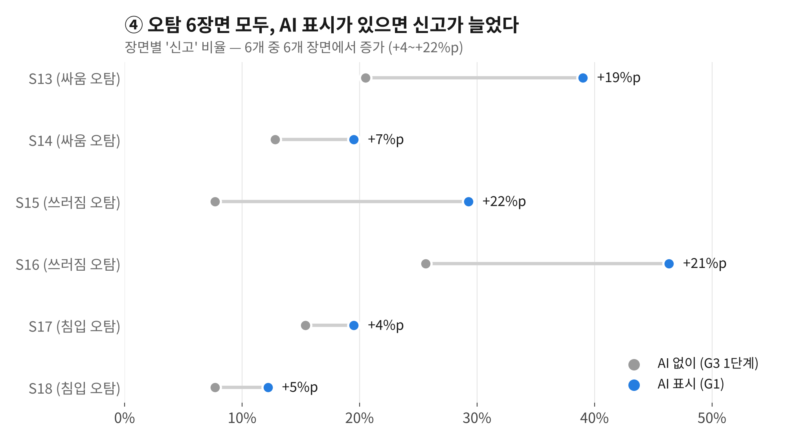
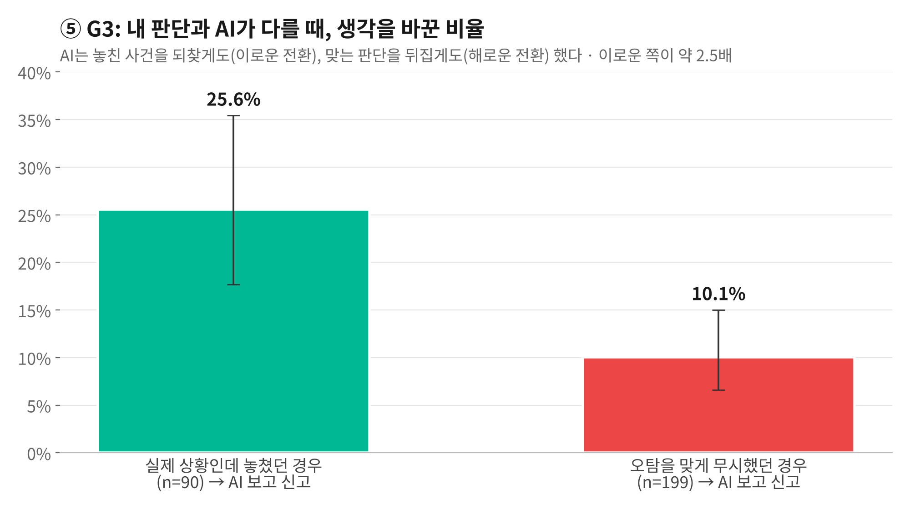
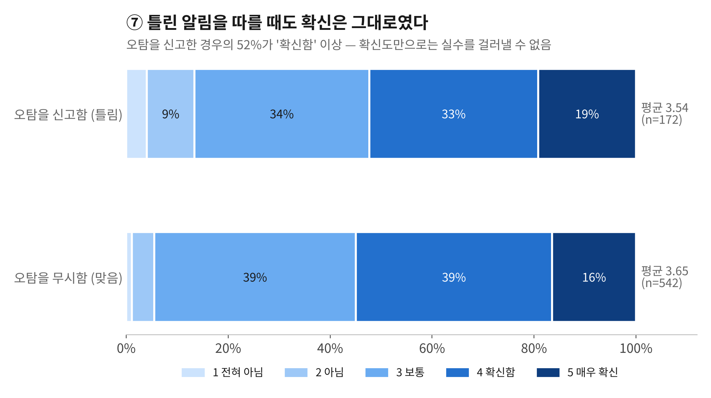

# 지능형 CCTV AI 알람과 자동화 편향 실험

**Intelligent CCTV × Automation Bias** — 지능형 CCTV의 AI 알람이 틀렸을 때, 사람은 그걸 걸러낼까 그냥 따라갈까?

> 데이터사이언스개론 팀 프로젝트 (서울여자대학교, 2026-2) · PsyToolkit 온라인 실험 · 참가자 119명



## 한 줄 결론

AI 표시를 처음부터 본 사람은 AI 없이 본 사람보다 **틀린 알람을 약 1.8배 더 따랐고**(15.0% → 27.6%, p = .015), 실제 사건을 더 잘 잡지도 못했다. 반면 **AI를 보기 전에 먼저 스스로 판단하게 한 방식**은 진짜와 오탐을 구분하는 능력(d′)이 가장 높았다. 생성형 AI 보고서는 판단 시간만 1.7배 늘렸다.

## 연구 배경

지능형 CCTV는 싸움·쓰러짐·침입 같은 이벤트를 AI가 감지해 관제요원에게 알린다. 최종 판단은 사람이 하므로 안전하다고 여겨지지만, 사람이 AI를 과하게 믿으면 AI의 오탐(false alarm)이 그대로 신고로 이어진다. 이 현상을 **자동화 편향(automation bias)** 이라고 한다. 이 프로젝트는 AI 알람을 보여주는 방식에 따라 자동화 편향이 달라지는지 실험으로 확인했다.

## 실험 설계

| 그룹 | 화면 구성 | 인원 |
|---|---|---|
| G1 라벨 | 장면 + AI 이벤트 라벨 + 빨간 상자 | 41 |
| G2 보고서 | G1 + 생성형 AI 분석 보고서 (일시·장소·이벤트·분석) | 39 |
| G3 선판단 | 장면만 보고 1차 판단 → AI 라벨·상자 공개 → 최종 판단 | 39 |

- 장면 18개 (AI가 맞은 **정탐** 12개 + AI가 틀린 **오탐** 6개), 무작위 순서
- 각 장면마다 [신고]/[무시] 선택 + 확신도(1~5)
- 사후 설문: AI 신뢰, 판단 근거, AI 사용 경험, 인구통계
- 장면 이미지: AI Hub 「지능형 관제 서비스 CCTV 영상 데이터」 (라이선스상 이 레포에는 포함하지 않음)

## 분석 방법

| 지표 | 계산 | 의미 |
|---|---|---|
| 오탐 수용률 | 오탐 6장면 중 신고 비율 | 틀린 AI를 따른 정도 (자동화 편향) |
| 정탐 신고율 | 정탐 12장면 중 신고 비율 | 실제 사건을 잡은 정도 |
| **판별력 d′** | z(정탐 신고율) − z(오탐 수용률) | 신호탐지이론 기반, 신고 성향과 분리된 구분 능력 |
| 기준 c | −(z(정탐) + z(오탐)) / 2 | 신고 쪽으로 기운 정도 |
| 균형 정답률 | (정탐 신고율 + 오탐 무시율) / 2 | 12:6 불균형 보정 정답률 (보조) |

- **"AI 없이" 기준선**: G3의 1단계 판단(AI 표시를 보기 전)을 기준선으로 사용
- 0%·100% 비율은 로그선형 보정(Hautus, 1995)
- 참가자 단위 비모수 검정 (Kruskal-Wallis, Mann-Whitney U + Holm 보정, Wilcoxon), 부트스트랩 95% 신뢰구간
- 보충: 판단 단위 로지스틱 GEE, 장면별 부호검정, 민감도 분석, 검정력 분석

## 주요 결과

| | AI 없이 (G3 1단계) | G3 최종 | G2 보고서 | G1 라벨 |
|---|---|---|---|---|
| 오탐 수용률 | **15.0%** | 20.1% | 24.4% | **27.6%** |
| 정탐 신고율 | 80.8% | 84.8% | 77.6% | 77.6% |
| 판별력 d′ | 1.90 | **1.90** | 1.52 | 1.43 |
| 오탐 판단 시간 | – | 3.3초 | **6.6초** | 3.9초 |

1. **자동화 편향 확인** — AI 표시로 오탐 수용률 +12.7%p (95% CI 2.8~22.9%p, p = .015). 오탐 6장면 **모두** 같은 방향 (부호검정 p = .031). 정탐 신고율은 늘지 않음.
2. **먼저 판단하면 판별력이 지켜진다** — d′ G3 > G1 (p = .005), G3 > G2 (p = .019). 판단이 다를 때 AI가 놓친 사건을 되찾게 한 비율(25.6%)이 맞는 판단을 뒤집은 비율(10.1%)의 약 2.5배.
3. **보고서는 시간만 늘렸다** — G2 판단 시간 1.7배 (p < .001), 오탐 수용률은 G1과 차이 없음.
4. **사람은 편향을 알아차리지 못한다** — 틀린 알람을 따른 경우의 52%가 "확신함" 이상. "AI를 참고했다"는 자기보고와 실제 행동의 상관 ρ = 0.10.

| | |
|---|---|
|  |  |
|  |  |

### 한계

- "AI 없이" 기준선은 G3 참가자의 판단(집단 간 비교)
- 그룹당 약 40명 → 효과크기 d ≥ 0.63 정도만 안정적으로 탐지
- 일반인 참가자, 정지 장면, 주로 휴대폰 환경 (실제 관제의 다중 화면·시간 압박은 재현하지 않음)

## 레포 구성

```
├── automation_bias_analysis.ipynb  # 전처리 → EDA → KPI → 검정 → 민감도 분석 → 차트 (전체 분석)
├── scenes.csv                      # 장면 정보 (정답, 라벨, 상자·감시구역 좌표, 보고서 문구, 줌)
├── extract_scenes.py               # 원본 영상 → 장면 프레임 추출
├── make_stimuli.py                 # 장면 프레임 → 그룹별 실험 화면 생성
├── make_psytoolkit.py              # 실험 화면 → PsyToolkit 실험 스크립트 생성
├── box_tool.html                   # 상자·감시구역 좌표 지정 도구
└── results/charts/                 # 발표용 차트 9장
```

## 실행 방법

참가자 원자료는 개인정보 보호를 위해 포함하지 않았다. 원자료가 있다면 `data_1123/`(PsyToolkit export: `data.csv`, `experiment_data/`)에 두고 노트북을 실행한다.

```bash
pip install pandas numpy scipy matplotlib statsmodels
jupyter notebook automation_bias_analysis.ipynb
```

## 참고문헌

- Hautus, M. J. (1995). Corrections for extreme proportions and their biasing effects on estimated values of d′. *Behavior Research Methods, Instruments, & Computers*, 27(1), 46–51.
- 데이터: AI Hub, 지능형 관제 서비스 CCTV 영상 데이터
